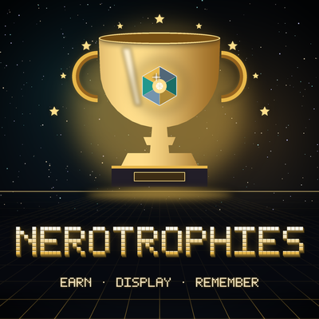

# NeroTrophies



**NeroTrophies** is the cross-mod achievement layer of the Neroland mod family. It listens for milestones from
every Nero mod, awards trophies defined in JSON, and gives you trophy blocks, pedestals and cabinets so your base
becomes a record of what you have done across the whole family.

> **Status: 0.0.1-alpha.1 — scaffold only.** This build registers the mod, its (empty) creative tab, its config
> and its crash-reporting opt-out. It has no trophies yet.

## Requirements

- Minecraft 26.3 (also built for 26.2, 26.1.2 and 1.21.1 / 1.21.4 / 1.21.5 / 1.21.7-1.21.8 / 1.21.9-1.21.10 /
  1.21.11)
- Fabric (with Fabric API), NeoForge or Forge
- [Neroland Core](https://github.com/Neroland/neroland-core) 1.19.0 or newer (below 2.0)

NeroTrophies depends on Neroland Core and nothing else. Trophies never gate gameplay: they are a record and a
cosmetic.

## Privacy

This version stores no player data. See [PRIVACY.md](PRIVACY.md) for what later versions will store and how to
export or erase it.

## Building

```text
./gradlew :neoforge:26.3:build :fabric:26.3:build :forge:26.3:build
./gradlew :fabric:26.3:ecjCheck
```

Build each cell explicitly (`:<loader>:<minecraft>:build`); a plain `build` is not supported. Neroland Core is
resolved from `mavenLocal()` or GitHub Packages, see [USING-CORE.md](USING-CORE.md).

## License

All Rights Reserved; modpacks allowed. See [LICENSE](LICENSE).
